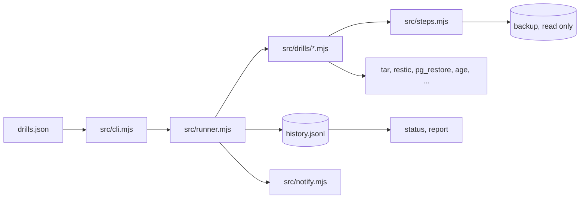

# restore-drill: how it is built

A zero-dependency Node 22 command line tool in ES modules. It runs as a short-lived process, with no daemon and no server. Each run reads a JSON config, restores the newest backup of each drill into a temp dir by calling the real tools, and appends one result line per drill to a history file. <!-- src: package.json:14, package.json:5, README.md:5 -->

## Components

- `bin/restore-drill.mjs` calls `main` and sets the exit code. <!-- src: bin/restore-drill.mjs -->
- `src/cli.mjs` parses arguments for `run`, `status`, `report`, `init` and `demo`, prints results and maps errors to exit codes: 2 for usage or config errors, 1 for a failed drill or an internal error. <!-- src: src/cli.mjs:35-41, src/cli.mjs:73-96, src/cli.mjs:175-186 -->
- `src/config.mjs` validates the config and rejects unknown options, with per-type allowed keys. Relative paths resolve against the config file. <!-- src: src/config.mjs:15-28, src/config.mjs:94, src/config.mjs:138-139 -->
- `src/runner.mjs` runs each drill in a private temp dir with a timeout and retries, builds the result record, notifies, and installs the signal handlers. <!-- src: src/runner.mjs:26-86, src/runner.mjs:99-112, src/runner.mjs:114-136 -->
- `src/drills/` holds one module per drill type: `file`, `sqlite`, `tar`, `restic`, `pg_dump` and `command`. <!-- src: src/runner.mjs:14 -->
- `src/steps.mjs` finds the newest backup, applies the age, size and size-drop checks, then decrypts and decompresses into the temp dir. <!-- src: src/steps.mjs:1-2, src/steps.mjs:11-38, src/steps.mjs:55-118 -->
- `src/sqlite-worker.mjs` runs the SQLite checks in a separate process and also builds the demo database. <!-- src: src/sqlite-worker.mjs:1-3 -->
- `src/util.mjs` holds duration and size parsing, glob expansion, temp dir handling, secret redaction and `exec`, the only place child processes are spawned. <!-- src: src/util.mjs:12-60, src/util.mjs:69-72, src/util.mjs:105-166, src/util.mjs:206-221, src/util.mjs:241-289 -->
- `src/history.mjs` reads, appends and summarises results. <!-- src: src/history.mjs:4-49 -->
- `src/notify.mjs` sends webhook, ntfy and ping requests. <!-- src: src/notify.mjs:1-46 -->
- `src/report.mjs` renders one self-contained HTML status page, and `src/demo.mjs` runs the four fake-backup demo. <!-- src: src/report.mjs:82-110, src/demo.mjs:54-105 -->
- `scripts/release.mjs` plans and annotates a release for `publish.yml`, and `scripts/make-hero.mjs` regenerates the README terminal image. Neither ships in the npm package. <!-- src: scripts/release.mjs:1-12, scripts/make-hero.mjs:1-4, package.json:13 -->

## Data flow

1. `run` loads the config, optionally narrows to the `--only` drills, and reads prior history. <!-- src: src/cli.mjs:73-91, src/runner.mjs:114-117 -->
2. For each drill, the runner makes a temp dir with mode 700 under the OS temp dir and calls the drill module with a timeout signal. <!-- src: src/runner.mjs:27-37, src/util.mjs:206-211 -->
3. A file-based drill finds the newest match by modification time, then applies the empty, `max_age`, `min_size` and `size_drop` checks. <!-- src: src/steps.mjs:11-38, src/util.mjs:153-166 -->
4. Optional decrypt (age or gpg) and decompress (gz, zst, xz) write into the temp dir, then the drill's own check runs: SQLite checks on a private copy, `tar` list, end-of-archive check and extract, `restic restore` then `restic check`, `pg_restore` list and full read, or the user's command. <!-- src: src/steps.mjs:55-118, src/drills/sqlite.mjs:7-25, src/drills/tar.mjs:68-88, src/drills/restic.mjs:25-63, src/drills/pg_dump.mjs:79-95, src/drills/command.mjs:5-16 -->
5. The temp dir is removed whatever happened, and the record (ok, timing, backup path, size, mtime, redacted error capped at 4000 characters) is appended to history. <!-- src: src/runner.mjs:50-54, src/runner.mjs:72-85, src/runner.mjs:15, src/runner.mjs:124 -->
6. A failure notifies by webhook and ntfy, and a pass after a failure sends a recovery notice. After the last drill one GET goes to `ping_success` or `ping_fail`. <!-- src: src/runner.mjs:130-135, src/notify.mjs:18-46 -->
7. `status` and `report` read the same history and print a table or write the HTML page. <!-- src: src/cli.mjs:98-133 -->

## Storage

- `<state>/history.jsonl` holds one JSON line per drill per run. The state directory is `--state`, then the config's `state`, then `.restore-drill` in the working directory. The directory is created with mode 700 and the file with mode 600. <!-- src: src/history.mjs:4-5, src/history.mjs:25-28, src/cli.mjs:46-50 -->
- A torn or hand-edited history line is skipped when reading. <!-- src: src/history.mjs:20 -->
- Temp dirs hold decrypted, decompressed and restored copies for one attempt. They are never the source, and are always removed. <!-- src: src/util.mjs:206-220, src/runner.mjs:50-54 -->
- The tool writes no database and keeps no cache. The only other output is the HTML file `report` writes, or `init` writes for a config. <!-- src: src/cli.mjs:126-143 -->

## Auth

No login and no listener: it is a local command that opens no port. Access is whatever the user running it has on the backup paths, the restic repository and the Postgres scratch server. <!-- src: src/cli.mjs, src/notify.mjs -->

Secrets are masked in output and history: credentials in URLs, the restic password and the database password. Notification URLs never appear in output. <!-- src: src/util.mjs:68-73, src/drills/restic.mjs:17-23, src/drills/pg_dump.mjs:20-24, src/notify.mjs:3-14 -->

## External services

- Binaries it runs: `tar`, `unzip`, `age`, `gpg`, `zstd`, `xz`, `restic`, `pg_restore`, `psql`, and `/bin/sh` for a string `command`. A missing one fails that drill with a "not found in PATH" error. <!-- src: src/drills/tar.mjs:74-80, src/steps.mjs:61-67, src/steps.mjs:94, src/drills/restic.mjs:34, src/drills/pg_dump.mjs:27, src/drills/pg_dump.mjs:44, src/drills/pg_dump.mjs:81, src/drills/pg_dump.mjs:91, src/drills/command.mjs:11, src/util.mjs:276-277 -->
- restic reads `RESTIC_PASSWORD`, `RESTIC_PASSWORD_FILE` and `RESTIC_PASSWORD_COMMAND` from the environment, or the variable a drill names in `password_env`. <!-- src: src/drills/restic.mjs:6-23 -->
- The `pg_dump` drill with `restore_url` passes `PGHOST`, `PGPORT`, `PGUSER`, `PGPASSWORD` and `PGSSLMODE` to `psql` and `pg_restore`. <!-- src: src/drills/pg_dump.mjs:7-18 -->
- Notification URLs come from the config's `notify` block (`webhook`, `ping_success`, `ping_fail`, `ntfy`), each an http or https URL, with a 10 second timeout. A failed send is a warning and never changes the exit code. <!-- src: src/config.mjs:29, src/config.mjs:160-169, src/notify.mjs:1-14 -->
- The npm registry and the GitHub CLI are used only by `scripts/release.mjs` in CI. `publish.yml` reads the `NPM_TOKEN` secret, or uses npm trusted publishing. <!-- src: scripts/release.mjs:83-93, .github/workflows/publish.yml:7-15, .github/workflows/publish.yml:51-90 -->
- CI runs `node --test` on Node 22 and 24, weekly and on every push and pull request. `upkeep.yml` checks README links with lychee and runs `dossier-scribe` weekly. <!-- src: .github/workflows/ci.yml:3-12, .github/workflows/ci.yml:34, .github/workflows/upkeep.yml:1-3, .github/workflows/upkeep.yml:25-32, .github/workflows/upkeep.yml:62-70 -->

## Unverified

- Behaviour on Windows, macOS, Borg, a restic repository over the network, or any Postgres other than 16. The README and reference say these are untested; the code was not run against them here.

## Generated facts

<!-- auto:start -->
- package: restore-drill 0.2.0
- npm scripts (1): test
<!-- auto:end -->
